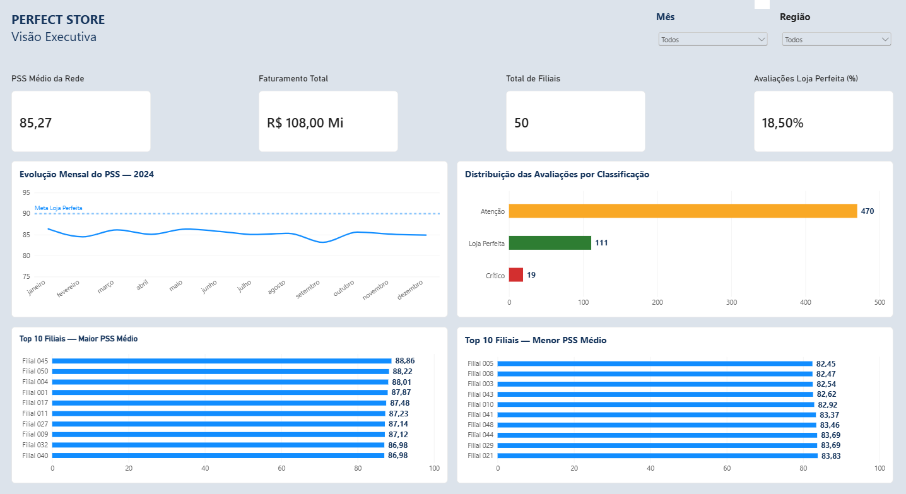
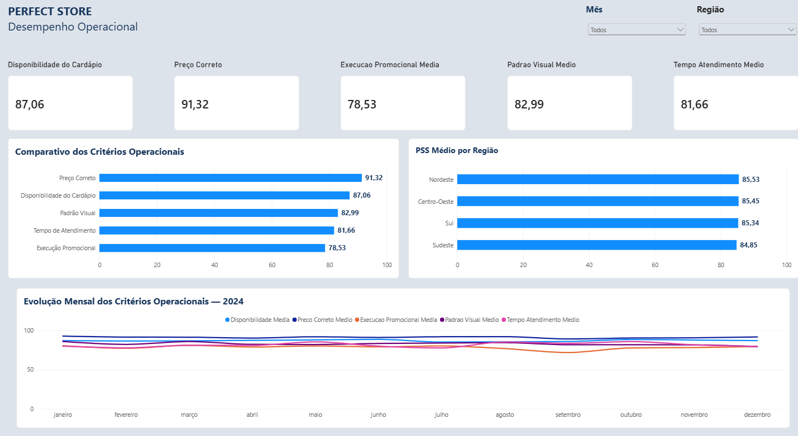
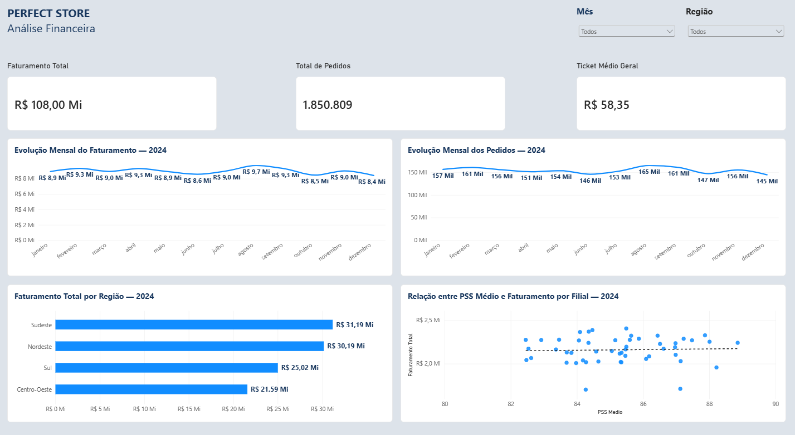
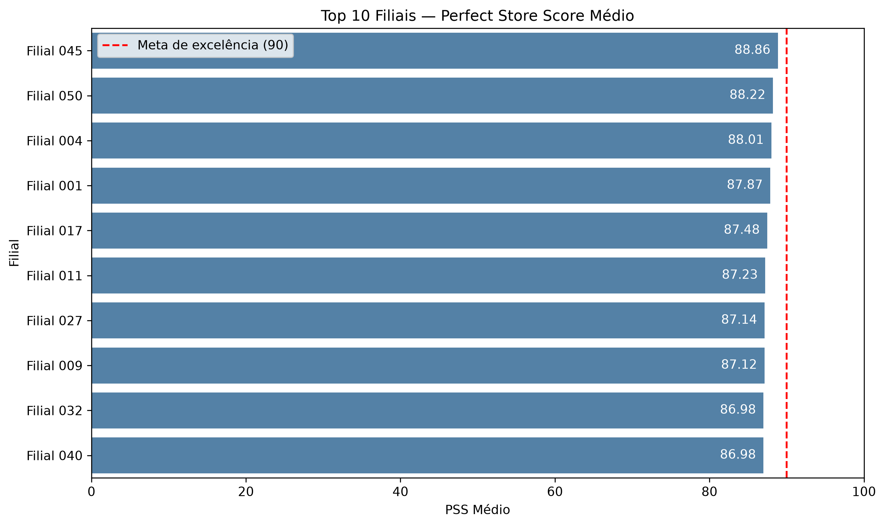
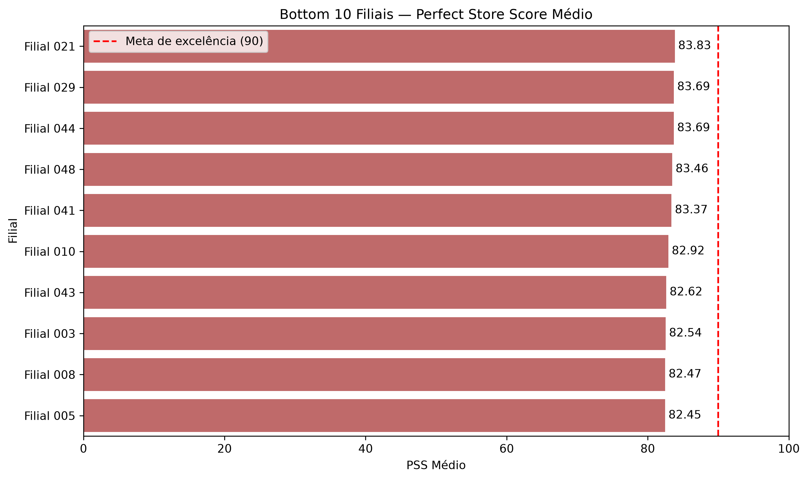
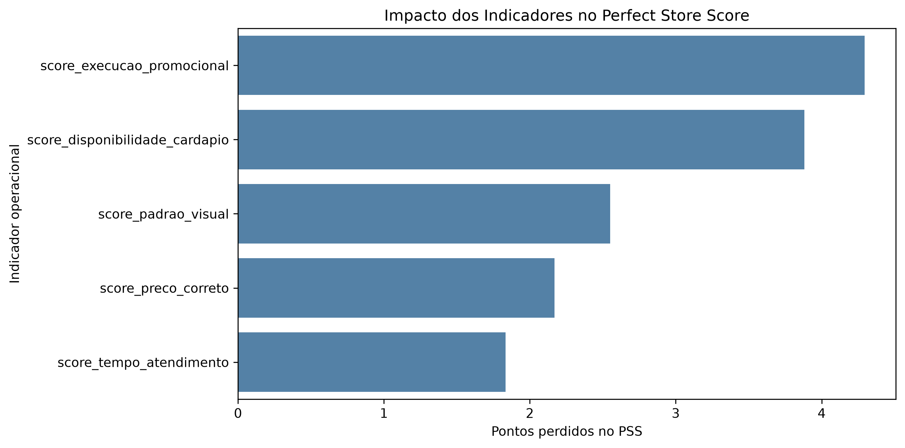
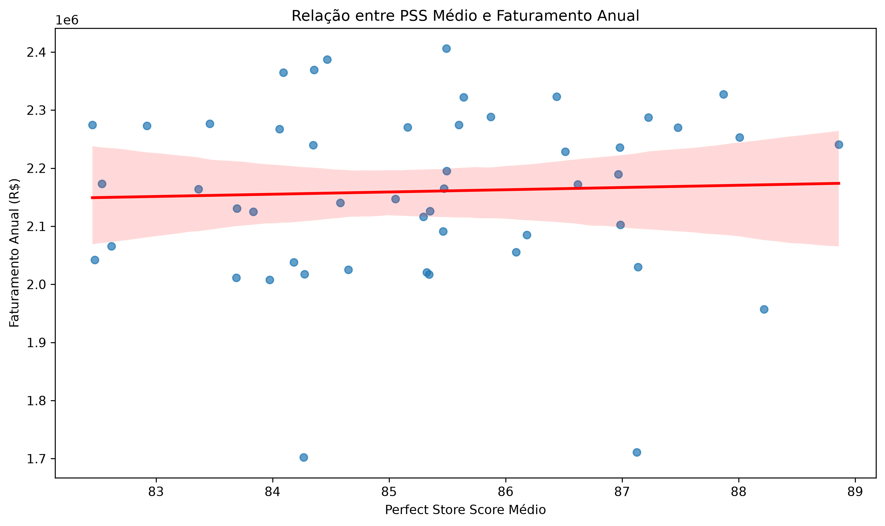

# Perfect Store Analysis

### Análise de desempenho operacional e financeiro de uma rede de restaurantes

Projeto de **Análise de Dados e Business Intelligence** desenvolvido com **Python e Power BI**, utilizando informações de **50 filiais e 600 avaliações mensais de 2024** para identificar oportunidades de melhoria operacional, monitorar indicadores de desempenho e investigar a relação entre qualidade operacional e resultados financeiros.

O projeto combina análise exploratória, validação de dados, estatística descritiva, visualizações em Python e um **dashboard interativo em Power BI**, permitindo explorar os resultados por período e região.

**Tecnologias:** Python · Pandas · NumPy · Matplotlib · Seaborn · Jupyter Notebook · Excel · Power BI · Power Query · DAX

---

## Resultados em destaque

| Indicador | Resultado |
| :--- | ---: |
| Filiais analisadas | 50 |
| Avaliações mensais | 600 |
| Período analisado | Janeiro a dezembro de 2024 |
| PSS médio da rede | 85,27 |
| Melhor filial | Filial 045 — PSS 88,86 |
| Menor desempenho anual | Filial 005 — PSS 82,45 |
| Avaliações classificadas como Loja Perfeita | 18,50% |
| Filiais que atingiram a meta anual de 90 pontos | 0 |
| Faturamento total | R$ 108,00 milhões |
| Total de pedidos | 1.850.809 |
| Ticket médio geral | R$ 58,35 |
| Principal oportunidade de melhoria | Execução promocional |
| Correlação anual entre PSS e faturamento | 0,0416 |

**Principal descoberta:** nenhuma filial atingiu a meta de excelência operacional na média anual. A execução promocional e a disponibilidade do cardápio foram os indicadores com maior impacto negativo no Perfect Store Score.

A análise também identificou uma correlação linear praticamente nula entre o PSS médio anual e o faturamento das filiais, indicando que essa associação não foi evidenciada na amostra analisada.

---

## Dashboard interativo — Power BI

O projeto inclui um dashboard desenvolvido no **Microsoft Power BI Desktop**, organizado em três páginas complementares.

O relatório apresenta indicadores-chave de desempenho (KPIs), séries temporais, rankings, análises regionais e gráficos de dispersão, além de filtros interativos por mês e região.

### 1. Visão Executiva

Página dedicada ao acompanhamento dos principais indicadores operacionais e financeiros da rede.

**Indicadores apresentados:**

| Indicador | Resultado |
| :--- | ---: |
| PSS médio da rede | 85,27 |
| Faturamento total | R$ 108,00 milhões |
| Total de filiais | 50 |
| Avaliações Loja Perfeita | 18,50% |

**Visualizações:**

- Evolução mensal do PSS em 2024, com referência à meta de 90 pontos.
- Distribuição das avaliações por classificação operacional.
- Ranking das dez filiais com maior PSS médio anual.
- Ranking das dez filiais com menor PSS médio anual.

A distribuição das 600 avaliações mensais apresentou:

| Classificação | Quantidade |
| :--- | ---: |
| Atenção | 470 |
| Loja Perfeita | 111 |
| Crítico | 19 |
| **Total** | **600** |

**Insight:** apesar de existirem avaliações mensais com desempenho excelente, nenhuma das 50 filiais alcançou a meta de 90 pontos considerando a média anual.



### 2. Desempenho Operacional

Página dedicada à comparação dos cinco critérios utilizados no cálculo do Perfect Store Score.

| Critério operacional | Média |
| :--- | ---: |
| Preço correto | 91,32 |
| Disponibilidade do cardápio | 87,06 |
| Padrão visual | 82,99 |
| Tempo de atendimento | 81,66 |
| Execução promocional | 78,53 |

**Visualizações:**

- Comparativo dos cinco critérios operacionais.
- PSS médio por região.
- Evolução mensal dos critérios operacionais em 2024.

O gráfico comparativo permite identificar rapidamente os indicadores com maior e menor pontuação média.

**Insight:** o preço correto apresentou a melhor avaliação média, enquanto a execução promocional registrou o menor desempenho, indicando uma oportunidade prioritária de melhoria.



### 3. Análise Financeira

Página dedicada ao acompanhamento dos resultados financeiros da rede e à investigação de sua relação com o desempenho operacional.

**Indicadores apresentados:**

| Indicador | Resultado |
| :--- | ---: |
| Faturamento total | R$ 108,00 milhões |
| Total de pedidos | 1.850.809 |
| Ticket médio geral | R$ 58,35 |

**Visualizações:**

- Evolução mensal do faturamento em 2024.
- Evolução mensal do número de pedidos.
- Faturamento total por região.
- Relação entre PSS médio e faturamento anual por filial.

O gráfico de dispersão permite observar a distribuição das 50 filiais de acordo com seus indicadores operacionais e financeiros.

**Insight:** a análise exploratória não identificou associação linear relevante entre o PSS médio anual e o faturamento das filiais.



### Recursos técnicos do dashboard

- **Power Query:** importação, preparação e definição dos tipos de dados.
- **DAX:** cálculo do PSS ponderado, classificação operacional e medidas de desempenho.
- **KPIs:** acompanhamento dos indicadores operacionais e financeiros.
- **Gráficos de linhas:** análise de evolução mensal.
- **Gráficos de barras:** comparação de critérios, regiões e filiais.
- **Gráfico de dispersão:** investigação da relação entre PSS e faturamento.
- **Segmentação de dados:** filtros por mês e região, com seleções independentes em cada página.

O dashboard pode ser aberto no Power BI Desktop pelo arquivo [`DashPSS.pbix`](DashPSS.pbix).

---

## Visualizações da análise em Python

Além do dashboard interativo, foram produzidas visualizações estáticas durante a análise exploratória desenvolvida em Python.

### 1. Ranking das 10 melhores filiais

Comparação das filiais com maior Perfect Store Score médio anual, utilizando a meta de 90 pontos como referência.



### 2. Ranking das 10 filiais com menor desempenho

Identificação das unidades com menor PSS médio anual e maior necessidade de acompanhamento operacional.



### 3. Impacto dos indicadores operacionais

Avaliação da contribuição de cada indicador para a perda de pontos no PSS, considerando seu peso na composição do índice.



**Destaque:** execução promocional e disponibilidade do cardápio representam, juntas, aproximadamente 55,5% dos pontos perdidos no indicador.

### 4. Relação entre PSS e faturamento anual

Análise exploratória da associação entre o desempenho operacional médio e o faturamento anual das 50 filiais.



**Resultado:** a correlação de Pearson foi de aproximadamente 0,0416, indicando ausência de associação linear relevante nesta amostra.

---

## Objetivo do projeto

Avaliar o desempenho operacional de uma rede de restaurantes por meio do **Perfect Store Score (PSS)**, um indicador composto por cinco critérios ponderados.

A análise busca responder às seguintes perguntas de negócio:

- Quais filiais apresentam os melhores e piores desempenhos?
- Quais indicadores operacionais mais prejudicam o PSS?
- Como o desempenho varia entre regiões e ao longo do ano?
- Existe associação entre o PSS e o faturamento ou ticket médio?
- Quais oportunidades de melhoria podem ser priorizadas pela gestão?

---

## Base de dados

O conjunto de dados contém **600 registros**, correspondentes a 50 filiais avaliadas mensalmente durante os 12 meses de 2024.

As informações incluem:

- Código da filial, cidade e região.
- Mês de referência.
- Cinco indicadores de desempenho operacional.
- Faturamento mensal.
- Número de pedidos.
- Ticket médio.

### Validação dos dados

Foram realizadas verificações de valores ausentes, duplicidades, intervalos dos indicadores, cobertura mensal e consistência cadastral.

A base não apresentou valores ausentes nem duplicidades nas combinações de filial e mês.

Entretanto, foram identificadas inconsistências na associação dos códigos das filiais às cidades e regiões. Essa limitação foi considerada durante a análise e deve ser observada na interpretação dos resultados regionais.

---

## Metodologia

### Cálculo do Perfect Store Score

O PSS foi calculado utilizando a média ponderada de cinco indicadores:

| Indicador | Peso |
| :--- | ---: |
| Disponibilidade do cardápio | 30% |
| Preço correto | 25% |
| Execução promocional | 20% |
| Padrão visual | 15% |
| Tempo de atendimento | 10% |
| **Total** | **100%** |

Cada indicador recebe uma pontuação de 0 a 100.

A fórmula aplicada foi:

**PSS = (Disponibilidade × 0,30) + (Preço × 0,25) + (Promoções × 0,20) + (Padrão Visual × 0,15) + (Atendimento × 0,10)**

### Classificação operacional

| Classificação | Faixa de PSS |
| :--- | :--- |
| Loja Perfeita | PSS ≥ 90 |
| Atenção | 75 ≤ PSS < 90 |
| Crítico | PSS < 75 |

### Etapas da análise

1. Importação e exploração dos dados.
2. Validação e verificação de consistência.
3. Cálculo do Perfect Store Score.
4. Classificação das avaliações mensais.
5. Construção do ranking anual das filiais.
6. Análise dos indicadores com maior perda ponderada.
7. Comparação regional e evolução mensal.
8. Análise de correlação entre PSS e indicadores financeiros.
9. Construção das visualizações em Python.
10. Desenvolvimento de medidas e indicadores em DAX.
11. Criação do dashboard interativo em Power BI.
12. Validação dos filtros e resultados apresentados.

---

## Principais conclusões

### Desempenho das filiais

A **Filial 045** apresentou o maior PSS médio anual, com **88,86 pontos**, enquanto a **Filial 005** registrou o menor, com **82,45 pontos**.

Todas as 50 filiais permaneceram na classificação "Atenção" quando considerada a média anual.

Nas avaliações mensais, 18,50% dos registros alcançaram a classificação "Loja Perfeita".

### Indicadores prioritários

A execução promocional apresentou a maior perda ponderada, aproximadamente **4,29 pontos de PSS**, seguida pela disponibilidade do cardápio, com **3,88 pontos**.

Esses resultados indicam onde as ações de melhoria operacional podem ter maior impacto sobre o índice.

### Desempenho regional

O Nordeste apresentou o maior PSS médio registrado (**85,53**), enquanto o Sudeste apresentou o menor (**84,85**).

Essas comparações consideram a região informada em cada registro mensal e devem ser interpretadas com cautela devido às inconsistências cadastrais.

### Evolução mensal

O PSS médio apresentou uma redução de **1,46 ponto** entre janeiro e dezembro de 2024.

Janeiro registrou o maior PSS médio mensal, enquanto setembro apresentou o menor.

### Relação com indicadores financeiros

As correlações anuais calculadas foram:

| Relação analisada | Correlação de Pearson |
| :--- | ---: |
| PSS × Faturamento anual | 0,0416 |
| PSS × Ticket médio anual | −0,0404 |

Os resultados não indicaram associações lineares relevantes.

Isso não significa que a qualidade operacional não influencia os resultados financeiros, mas que essa relação não foi evidenciada pelas correlações calculadas nesta base.

---

## Recomendações de negócio

- **Execução promocional:** investigar falhas na implementação das campanhas e monitorar sua conformidade.
- **Disponibilidade do cardápio:** identificar causas de indisponibilidade e melhorar o planejamento de abastecimento.
- **Filiais com menor desempenho:** estabelecer planos de ação e acompanhar a evolução mensal dos indicadores.
- **Boas práticas:** investigar os processos das filiais mais bem avaliadas e considerar sua replicação.
- **Qualidade cadastral:** corrigir as associações entre filiais, cidades e regiões para permitir análises geográficas confiáveis.
- **Monitoramento contínuo:** utilizar o dashboard para acompanhar tendências, identificar desvios e apoiar decisões operacionais.

---

## Limitações da análise

Os mesmos códigos de filiais aparecem associados a diferentes cidades e regiões durante o período analisado.

Para evitar distorções:

- O ranking anual foi calculado exclusivamente pelo código da filial.
- As comparações regionais utilizaram a região registrada em cada avaliação mensal.
- Não foi elaborado um mapa geográfico das filiais, pois a localização cadastral não é confiável.
- As análises de correlação são exploratórias e não estabelecem relações de causa e efeito.

A correção dos dados cadastrais é recomendada antes de realizar análises geográficas mais detalhadas.

---

## Estrutura do projeto

```text
perfect-store-analysis/
├── data/
│   └── projeto1_vendas_perfect_store.xlsx
├── images/
│   ├── top_10_filiais.png
│   ├── bottom_10_filiais.png
│   ├── impacto_indicadores.png
│   ├── pss_faturamento_anual.png
│   ├── visao-executiva.png
│   ├── desempenho-operacional.png
│   └── analise-financeira.png
├── notebooks/
│   └── perfect_store_analysis.ipynb
├── src/
├── DashPSS.pbix
├── .gitignore
└── README.md
```

A pasta `.venv/` é utilizada localmente para o ambiente virtual Python e não deve ser versionada no GitHub.

---

## Como executar o projeto

### 1. Clonar o repositório

```bash
git clone https://github.com/DanielDevCC26/perfect-store-analysis.git
cd perfect-store-analysis
```

### 2. Preparar o ambiente Python

Crie e ative um ambiente virtual Python.

Instale as dependências:

```bash
pip install pandas numpy matplotlib seaborn jupyter openpyxl
```

### 3. Executar a análise em Python

Abra o arquivo:

`notebooks/perfect_store_analysis.ipynb`

Selecione o ambiente virtual como kernel do Jupyter e execute as células na ordem apresentada.

O notebook utiliza o arquivo Excel disponível na pasta `data/`.

### 4. Abrir o dashboard no Power BI

1. Instale o Microsoft Power BI Desktop, caso ainda não esteja disponível.
2. Abra o arquivo `DashPSS.pbix`, localizado na raiz do projeto.
3. Navegue pelas páginas **Visão Executiva**, **Desempenho Operacional** e **Análise Financeira**.
4. Utilize os filtros de mês e região para explorar os indicadores.

Caso seja necessário atualizar a fonte de dados, configure o caminho do arquivo Excel localizado na pasta `data/` por meio das configurações de fonte de dados do Power BI.

---

## Status do projeto

**Concluído — Análise de Dados e Dashboard Power BI.**

Etapas finalizadas:

- Análise exploratória em Python.
- Validação e identificação de limitações da base.
- Construção do Perfect Store Score.
- Rankings e comparações operacionais.
- Visualizações e análise estatística.
- Análise de indicadores financeiros.
- Desenvolvimento do dashboard interativo em Power BI.
- Criação e validação de medidas DAX.
- Testes dos filtros e indicadores.
- Recomendações de negócio.

**Projeto desenvolvido para portfólio profissional em Análise de Dados e Business Intelligence.**